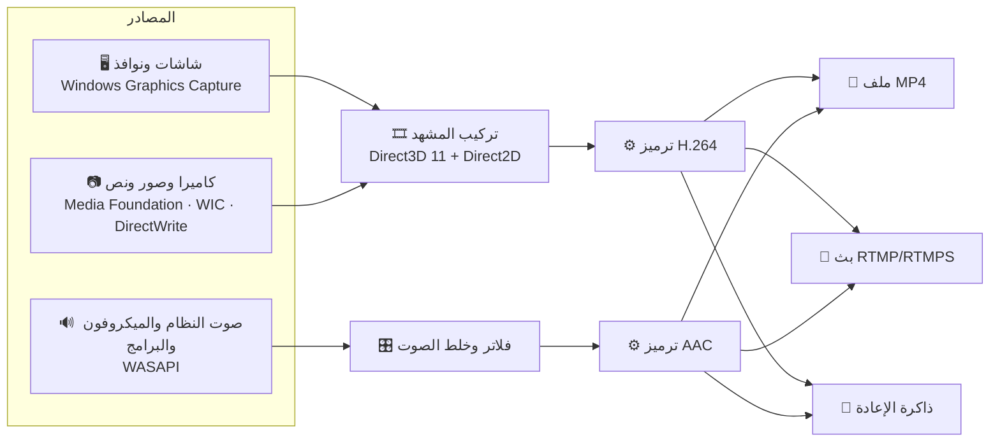

# 🎬 مسجّل الشاشة — Screen Recorder

**برنامج تسجيل وبث مباشر لويندوز، مكتوب من الصفر بلغة C++، بواجهة عربية كاملة**

🔴 تسجيل • 📡 بث لعدة منصات • 🎞️ مشاهد وطبقات • 🔁 إعادة فورية • 🎙️ فلاتر صوت

---

## ✨ لمحة سريعة

برنامج واحد يجمع **التسجيل** و**البث المباشر** و**التحرير الخفيف** في مكان واحد، على فكرة OBS لكن بواجهة أبسط وأجمل، وبالعربية من أول زر إلى آخر زر.

- ⚡ **خفيف وسريع**: التصوير والتركيب كلّه على **بطاقة الرسومات**
- 🛟 **لا يضيّع عملك**: صيغة MP4 آمنة حتى لو انقطعت الكهرباء
- 🎮 **مصمَّم للألعاب**: اختصارات تعمل داخل اللعبة، ومؤشر تسجيل صغير لا يظهر في الفيديو

---

## 🚀 المميزات

<b>🎞️ المشاهد والطبقات</b>

- مشاهد متعددة مثل OBS، والتبديل بينها بتلاشٍ ناعم (حتى أثناء التسجيل)
- مصادر: **شاشة كاملة**، **نافذة**، **كاميرا**، **صورة**، **نص**
- تحريك وتكبير بالفأرة، مع **التصاق تلقائي** بالحواف والمنتصف (Ctrl لإلغائه)
- ✂️ **قص الطبقات** بـ `Alt` + سحب المقبض (دون تمديد المحتوى)
- كاميرا بأشكال: مستطيل، زوايا مدوّرة، دائرة، مع عكس المرآة
- نافذة **"إضافة مصدر"** فيها بحث، ولقطات مصغّرة للشاشات، وأيقونات البرامج الحقيقية
- النوافذ المغلقة تعود للاتصال تلقائيًا فور فتحها

<b>🔊 الصوت</b>

- 🔈 **صوت النظام** و🎙️ **الميكروفون** مع اختيار الجهاز، وعلو من 0 إلى 200%، وكتم
- 🧩 **صوت برنامج معيّن فقط** (لعبة، ديسكورد، كروم...) دون إشعارات ويندوز، **ولكل مشهد أصواته**
- 🎛️ **فلاتر الميكروفون** بإعدادات مخصّصة ومقاييس حية بالديسيبل:
  - إزالة الضجيج (حتى 200%) مع تعلّم ضجيج الغرفة
  - بوابة الصوت (Noise Gate) بخط حدّ تسحبه على المقياس
  - توحيد مستوى الصوت (ضاغط + محدّد)
- 🎚️ **مسارات صوت منفصلة** في ملف MP4 (الكل، النظام، الميكروفون، البرامج)، ممتازة للمونتاج

<b>📡 البث المباشر</b>

- بث على **عدة منصات في الوقت نفسه**: يوتيوب، تويتش، فيسبوك، كيك، تيك توك، وخادم مخصّص
- RTMP و RTMPS، مع **إعادة اتصال تلقائية** عند انقطاع الإنترنت
- 📱 **بث عمودي 9:16** للمنصات القصيرة (قص المنتصف أو الشاشة كاملة)
- 🔐 مفاتيح البث **مشفّرة** على جهازك (Windows DPAPI)

<b>🔴 التسجيل والإعادة</b>

- H.264 + AAC بمشفّر **بطاقة الرسومات** أو **المعالج**، مع دقة وإطارات وجودة قابلة للتعديل
- ⏸️ إيقاف مؤقت واستكمال في الملف نفسه
- 🔁 **الإعادة الفورية**: احفظ آخر 15 / 30 / 60 / 120 ثانية بضغطة زر
- 🔴 **مؤشر تسجيل** صغير فوق الألعاب وسطح المكتب: الوقت، حالة الميكروفون، والإعادة، **ولا يظهر في التسجيل**

<b>⌨️ الاختصارات</b>

كل الاختصارات **قابلة للتغيير** من نافذة "اختصارات لوحة المفاتيح"، وتعمل حتى وأنت داخل اللعبة.

| الإجراء | الافتراضي |
|:--|:--:|
| 🔴 بدء التسجيل / إيقافه | `F9` |
| ⏸️ إيقاف مؤقت | `F10` |
| 📡 بدء البث / إيقافه | `F8` |
| 🔁 حفظ الإعادة | `F7` |
| 🎙️ كتم الميكروفون | — |
| 🔄 تشغيل الإعادة / إيقافها | — |
| ⏭️ المشهد التالي | — |
| 👁️ إظهار المؤشر / إخفاؤه | — |
| 🎬 التبديل إلى مشهد معيّن | لكل مشهد خانة خاصة |

وداخل البرنامج: الأرقام `1`–`9` لتبديل المشهد، والأسهم لتحريك الطبقة (`Shift` = أسرع).

---

## 🧠 كيف يعمل؟

| الجزء | التقنية |
|:--|:--|
| 🖌️ الواجهة | Direct2D + DirectWrite (مرسومة يدويًا، من اليمين لليسار بالكامل) |
| 🖥️ التصوير | Windows Graphics Capture + Direct3D 11 (ورجوع تلقائي لـ GDI) |
| 🎞️ الترميز | Media Foundation (H.264 + AAC) |
| 🔊 الصوت | WASAPI + Process Loopback لصوت البرامج |
| 🌐 الشبكة | Winsock + Schannel (TLS) |

---

## 🛠️ التشغيل من الكود

1. ثبّت **Visual Studio 2026** مع حزمة **Desktop development with C++**
2. افتح `Screen Recorder.slnx`
3. اضغط **Ctrl + F5** ▶️

**المتطلبات:** ويندوز 10 الإصدار **2004** أو أحدث، أو ويندوز 11.
(يتطلّب هذا الإصدار التقاطُ صوت البرامج منفصلًا وإخفاءُ المؤشر عن التسجيل)

<b>📁 ملفات المشروع</b>

| الملف | المحتوى |
|:--|:--|
| `main.cpp` | النافذة الرئيسية والتبويبات وربط الأجزاء ببعضها |
| `Ui` · `Panel` · `IconCache` | أدوات الرسم، ونظام النوافذ الداخلية، والأيقونات |
| `AddSourcePanel` · `AppAudioPanel` · `MicFiltersPanel` · `HotkeysPanel` | النوافذ الداخلية |
| `Capture` · `Gpu` · `Scene` | التصوير وتركيب المشهد على بطاقة الرسومات |
| `Media` | الكاميرا والصور والنص |
| `Audio` · `AudioFilters` · `AppAudio` | مصادر الصوت والفلاتر وأصوات البرامج |
| `Recorder` · `Encoders` | التسجيل لملف MP4 |
| `Streamer` · `Rtmp` · `Net` | البث المباشر |
| `Replay` | الإعادة الفورية |
| `Overlay` · `Hotkeys` | مؤشر التسجيل والاختصارات |

---

## 🗺️ الخطة القادمة

- [ ] 🎨 فلاتر الفيديو (سطوع، تباين، تشبّع) و🟩 الشاشة الخضراء للكاميرا
- [ ] 🌫️ خلفية ضبابية للبث العمودي
- [ ] 📦 نسخة Release وملف تثبيت

---

صُنع بـ ❤️ و ☕ — بالعربية، للعرب

