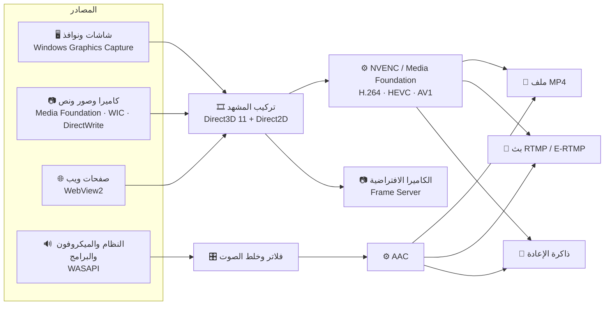

# 🎬 مسجّل الشاشة — Screen Recorder

**برنامج تسجيل وبث مباشر لويندوز، مكتوب من الصفر بلغة C++، بواجهة عربية كاملة**

🔴 تسجيل • 📡 بث لعدة منصات • 🔁 لقطات الألعاب • 🎞️ مشاهد وطبقات • 🌐 تنبيهات البث • 📷 كاميرا افتراضية • ▶️ مشغّل وقص

---

## ✨ لمحة سريعة

برنامج واحد يجمع **التسجيل** و**البث المباشر** و**لقطات الألعاب** و**التحرير الخفيف** في مكان واحد، على فكرة OBS لكن بواجهة أبسط وبالعربية من أول زر إلى آخر زر.

- 👋 **سهل من أول دقيقة**: عند أول تشغيل يسألك ماذا تريد (لقطات، تسجيل، بث) ويضبط كل شيء وحده، بلا مصطلحات تقنية
- ⚡ **خفيف وسريع**: التصوير والتركيب على **بطاقة الرسومات**، والترميز بمشفّر **NVIDIA المباشر** بأعلى إعدادات الجودة
- 🎮 **مصمَّم للألعاب**: يكشف اللعبة تلقائيًا، واختصارات تعمل داخلها، ومؤشر صغير لا يظهر في الفيديو
- 🛟 **لا يضيّع عملك**: صيغة MP4 آمنة حتى لو انقطعت الكهرباء، وتحذير قبل أن يمتلئ القرص، وسجل أعطال يساعد في إصلاح أي خطأ
- 🗂️ **كل شيء داخل البرنامج**: شاهد تسجيلاتك، وقصّها، ونظّمها دون أن تفتح أي برنامج آخر

---

## 📥 التنزيل

من **[صفحة آخر إصدار](https://github.com/levi113160909-bit/Screen-Recorder/releases/latest)** اختر واحدًا:

| الملف | لمن |
|:--|:--|
| `ScreenRecorder-Setup-<الإصدار>.exe` | **المثبّت** (مُستحسن): لا يحتاج صلاحية المسؤول، يضيف البرنامج إلى سطح المكتب وقائمة ابدأ، **وتصله التحديثات تلقائيًا** |
| `ScreenRecorder-v<الإصدار>-win64.zip` | **النسخة المحمولة**: فك الضغط وشغّل `ScreenRecorder.exe` مباشرة (لا تُحدَّث تلقائيًا) |

> قد يعرض ويندوز تحذير **SmartScreen** لأن البرنامج غير موقّع رقميًا: اضغط «مزيد من المعلومات» ثم «تشغيل على أي حال».

---

## 🆕 الجديد في الإصدار 1.5.0

- 🔄 **التحديث التلقائي**: ينزّل البرنامج الإصدارات الجديدة في الخلفية، ويتأكد من سلامتها ببصمة SHA-256، ثم يثبّتها عند فتحه المرة القادمة ويعيد تشغيل نفسه. أو فورًا من «تحديث الآن»
- 📦 **مثبّت عربي**: التالي ← التالي، وأيقونة على سطح المكتب وفي قائمة ابدأ، وإزالة نظيفة من «التطبيقات»
- ⚙️ تختار في الإعدادات ← عام ← التحديثات: **تلقائية** أو **إشعار فقط**

<b>الجديد في الإصدار 1.4.0</b>

- ⌨️ **الاختصارات تعمل داخل الألعاب التي تعمل كمسؤول** (مثل كثير من ألعاب مضاد الغش)
- 🛡️ **خيار «التشغيل كمسؤول»** في الإعدادات ← عام ← الصلاحية، والتشغيل مع ويندوز يبقى بلا طلب موافقة. ويخبرك البرنامج تلقائيًا إذا اكتشف لعبة تعمل كمسؤول
- 🔔 **الإشعارات على الشاشة التي تلعب عليها**، وتبقى فوق كل النوافذ، وتظهر بالترتيب دون أن يمحو أحدها الآخر
- 🎮 إذا كانت اللعبة بوضع **«ملء الشاشة الحصري»** يخبرك البرنامج لماذا لم تظهر الإشعارات فوقها وكيف تصلح ذلك

<b>الجديد في الإصدار 1.3.0</b>

- ▶️ **مشغّل فيديو وعارض صور داخل البرنامج**: صوت، وشريط تنقّل يعرض الوقت تحت الفأرة، وتقديم ورجوع 5 ثوانٍ بأسهم دائرية، ومستوى الصوت والكتم
- ✂️ **قص أسهل وأدق**: مشغّل بالصوت داخل نافذة القص، وزرّا **«البداية هنا»** و**«النهاية هنا»**، و**«تشغيل المقطع»** للتأكد قبل الحفظ
- 🗂️ **المعرض** صار أول قسم في الإعدادات، وكلمة «المعرض» تحت أيقونته في الشريط السفلي
- 💬 **تلميحات** تظهر عند الوقوف بالفأرة فوق أي زر بأيقونة
- 🧭 **قائمة أيقونة الساعة** بأيقونات لكل خيار، مع خيار «المعرض»
- 🛟 **سجل الأعطال**: إذا توقّف البرنامج فجأة يُحفظ تقرير مفصّل، ويخبرك البرنامج به في المرة التالية
- 📦 **مثبّت عربي** بلا صلاحية المسؤول، مع إزالة نظيفة (تسأل قبل حذف إعداداتك ولا تلمس تسجيلاتك)
- 🐞 **إصلاحات**: أزرار المعرض كانت تشغّل الفيديو بدل القص والحذف، وأخطاء نادرة في أرقام الأزرار عند كثرة المصادر أو المشاهد
- 🧱 **تنظيم داخلي كبير** للكود: كل ميزة في ملف، ويتحقق المترجم من سلامة الأرقام عند كل بناء

---

## 🚀 المميزات

<b>🔁 لقطات الألعاب (الإعادة الفورية)</b>

- احفظ **آخر 15 / 30 / 60 / 120 ثانية** بضغطة زر، مثل برنامج NVIDIA
- 🎮 **كشف الألعاب تلقائيًا**: تبدأ الإعادة وحدها عند فتح أي لعبة وتلتقط نافذة اللعبة نفسها
- جودة حتى **«فائقة»** لأن اللقطات القصيرة لا تأخذ مساحة كبيرة
- تعمل في الخلفية بلا أي أثر يُذكر على أداء اللعبة

<b>🔴 التسجيل</b>

- **H.264** و**HEVC (H.265)** و**AV1** بمشفّر بطاقة الرسومات أو المعالج
- ⚙️ **مشفّر NVIDIA المباشر (NVENC)**: إطارات B، ونظر للأمام (Lookahead)، وتكميم تكيّفي (AQ)، وتمريرتان، بإطارات ثابتة تمامًا (60 إطار/ث بالضبط)
- ⏸️ إيقاف مؤقت واستكمال في الملف نفسه
- 🚩 **العلامات**: اضغط زرًا عند اللحظات المهمة، فيُحفظ ملف فصول جاهز للصق في وصف يوتيوب
- 💽 **مراقبة القرص**: يعرض كم دقيقة تكفي المساحة، وينبّهك، ويوقف التسجيل بأمان قبل امتلاء القرص
- 🎚️ **مسارات صوت منفصلة** (الكل، النظام، الميكروفون، البرامج)، ممتازة للمونتاج

<b>📡 البث المباشر</b>

- بث على **عدة منصات في الوقت نفسه**: يوتيوب، تويتش، فيسبوك، كيك، تيك توك، وخادم مخصّص
- 🎥 **HEVC على يوتيوب** عبر Enhanced RTMP: صورة أوضح بالسرعة نفسها
- ⚙️ **إعدادات مستقلة لكل منصة** (الترميز ومعدّل البت)، و**مشاركة الترميز** بين المنصات المتطابقة لتوفير الجهد
- 📶 **معدّل بت ذكي**: يخفّض الجودة مؤقتًا إذا ضعف الإنترنت بدل أن يتقطّع البث، ثم يرفعها تدريجيًا
- 📊 **عدّاد الرفع**: مجموع استهلاك الرفع لكل المنصات، يظهر أيضًا بجانب «مباشر» في المؤشر العلوي
- 💾 **حفظ نسخة من البث** على جهازك بالجودة الأعلى، دون ترميز إضافي
- 📱 **بث عمودي 9:16** للمنصات القصيرة
- RTMP و RTMPS مع **إعادة اتصال تلقائية**، ومفاتيح البث **مشفّرة** على جهازك (Windows DPAPI)

<b>🎞️ المشاهد والمصادر</b>

- مشاهد متعددة، والتبديل بينها بتلاشٍ ناعم (حتى أثناء التسجيل)، وترقيم تلقائي مرتّب
- المصادر:
  - 🖥️ **شاشة كاملة** أو ✂️ **جزء من الشاشة** تحدّده بالفأرة
  - 🪟 **نافذة** (تعود للاتصال تلقائيًا إذا أُغلقت وفُتحت)
  - 📷 **كاميرا** بأشكال: مستطيل، زوايا مدوّرة، دائرة، مع عكس المرآة
  - 🖼️ **صورة** و🔤 **نص**
  - 🌐 **صفحة ويب**: تنبيهات المتابعين والتبرعات (Streamlabs، StreamElements...) وشات يوتيوب، بخلفية شفافة
  - 🔊 **صوت برنامج معيّن**
- 🟩 **إزالة الخلفية الخضراء (Chroma Key)** للكاميرا: قطّارة لاختيار اللون، ومعاينة حية، ونعومة الحواف، وإزالة الانعكاس الأخضر
- تحريك وتكبير بالفأرة مع **التصاق تلقائي** بالحواف والمنتصف، و**قص الطبقات** بـ `Alt` + سحب المقبض

<b>📷 الكاميرا الافتراضية</b> (ويندوز 11)

- اعرض مشهدك كاملًا (الشاشة + الكاميرا + الصور + النص) **ككاميرا ويب** في ديسكورد وزوم وتيمز والمتصفح
- تظهر باسم **«مسجّل الشاشة»** في قائمة الكاميرات
- لا ترسم شيئًا إلا عندما يفتحها برنامج فعلًا، فلا تستهلك الجهاز بلا داعٍ

<b>🔊 الصوت</b>

- 🔈 **صوت النظام** و🎙️ **الميكروفون** مع اختيار الجهاز، وعلو من 0 إلى 200%، وكتم
- 🧩 **صوت برنامج معيّن فقط** (لعبة، ديسكورد، كروم...) **ولكل مشهد أصواته**
- 🗣️ **اضغط لتتكلم (Push-to-Talk)** بأي زر في لوحة المفاتيح أو الفأرة
- 🎛️ **فلاتر الميكروفون** بمقاييس حية: إزالة الضجيج، بوابة الصوت، وتوحيد مستوى الصوت

<b>🗂️ المعرض والمشغّل والقص</b>

- **معرض** لكل التسجيلات والإعادات ونسخ البث ولقطات الشاشة، بصور مصغّرة وفلاتر، من الشريط السفلي أو من أول قسم في الإعدادات
- ▶️ **مشغّل داخل البرنامج** بنفس الثيم:
  - صورة وصوت، وشريط تنقّل يعرض الوقت تحت الفأرة
  - تقديم ورجوع 5 ثوانٍ، ومستوى الصوت والكتم
  - الاختصارات: `المسافة` تشغيل/إيقاف، `←` `→` خمس ثوانٍ، `M` كتم
- 🖼️ **عارض صور** للقطات الشاشة
- ✂️ **قص سريع** بلا إعادة ترميز وبالجودة الأصلية:
  - شاهد واسمع الفيديو داخل نافذة القص
  - **«البداية هنا»** (`I`) و**«النهاية هنا»** (`O`) عند اللحظة التي تراها، أو اسحب المقبضين على شريط الصور
  - **«تشغيل المقطع»** يعرض المقطع المحدد فقط قبل الحفظ
- إعادة تسمية، وفتح في المجلد، وحذف إلى سلة المحذوفات
- 📸 **لقطة شاشة** للمشهد بضغطة زر: تُحفظ PNG وتُنسخ للحافظة مباشرة

<b>🎨 الواجهة والتخصيص</b>

- واجهة عربية كاملة من اليمين لليسار، مرسومة بـ Direct2D
- ثلاثة مظاهر (داكن، أسود، كحلي) وألوان مميّزة، مع **منتقي ألوان** بدائرة الألوان لاختيار أي لون تريده
- إعدادات مرتّبة في صفحات: التسجيل، البث، الإعادة، الاختصارات، المؤشر، عام
- 💬 **تلميحات** لكل زر بأيقونة عند الوقوف فوقه بالفأرة
- 🧭 **أيقونة بجانب الساعة**: يبقى البرنامج يعمل عند إغلاق النافذة، وقائمتها بأيقونات (تسجيل، بث، إعادة، المعرض، الإعدادات)
- 🔄 **تحديث تلقائي**: ينزّل الإصدار الجديد من GitHub في الخلفية ويتحقق من سلامته ثم يثبّته ويعيد تشغيل نفسه
- 🔴 **مؤشر صغير** فوق الألعاب وسطح المكتب: الوقت، والميكروفون، والإعادة، والبث مع سرعة الرفع، **ولا يظهر في التسجيل**

<b>🛟 الثبات والأمان</b>

- **MP4 آمن**: الملف يبقى سليمًا حتى لو انقطعت الكهرباء أثناء التسجيل
- **سجل الأعطال**: إذا توقّف البرنامج فجأة يُحفظ تقرير (`.txt` مقروء و`.dmp` للتحليل) في `%LOCALAPPDATA%\ScreenRecorder\Crashes`، ويخبرك البرنامج به في التشغيل التالي (الإعدادات ← عام ← تقارير الأعطال)
- **نسخة واحدة فقط** من البرنامج تعمل في الوقت نفسه، وفتحه مرة ثانية يُظهر النسخة المفتوحة
- 🛡️ **التشغيل كمسؤول** (اختياري): لتعمل الاختصارات داخل الألعاب التي تعمل كمسؤول، مع تشغيل تلقائي مع ويندوز عبر «جدولة المهام» بلا طلب موافقة
- مفاتيح البث **مشفّرة** على جهازك، ولا يجمع البرنامج أي بيانات عنك: اتصاله بالإنترنت هو البث نفسه، والتحقق من التحديثات على GitHub فقط

<b>⌨️ الاختصارات</b>

كل الاختصارات **قابلة للتغيير**، وتقبل **أي زر** في لوحة المفاتيح أو **أزرار الفأرة الجانبية والوسطى**، وتعمل حتى داخل اللعبة، بما فيها الألعاب التي تعمل كمسؤول.

| الإجراء | الافتراضي |
|:--|:--:|
| 🔴 بدء التسجيل / إيقافه | `F9` |
| ⏸️ إيقاف مؤقت | `F10` |
| 📡 بدء البث / إيقافه | `F8` |
| 🔁 حفظ الإعادة | `F7` |
| 📸 لقطة شاشة | `Ctrl` + `F7` |
| 🚩 إضافة علامة | `Ctrl` + `F9` |
| 🗣️ اضغط لتتكلم | — |
| 🎙️ كتم الميكروفون | — |
| 🔄 تشغيل الإعادة / إيقافها | — |
| ⏭️ المشهد التالي | — |
| 👁️ إظهار المؤشر / إخفاؤه | — |
| 🎬 التبديل إلى مشهد معيّن | لكل مشهد خانة خاصة |

وداخل البرنامج: الأرقام `1`–`9` لتبديل المشهد، والأسهم لتحريك الطبقة (`Shift` = أسرع).
وفي المشغّل: `المسافة` و`←` `→` و`M`، وفي نافذة القص: `I` للبداية و`O` للنهاية.

---

## 🧠 كيف يعمل؟

| الجزء | التقنية |
|:--|:--|
| 🖌️ الواجهة | Direct2D + DirectWrite (مرسومة يدويًا، من اليمين لليسار بالكامل) |
| 🖥️ التصوير | Windows Graphics Capture + Direct3D 11 (ورجوع تلقائي لـ GDI) |
| 🎞️ الترميز | NVIDIA NVENC مباشرة، أو Media Foundation |
| 🔊 الصوت | WASAPI + Process Loopback لصوت البرامج |
| 🌐 صفحات الويب | Microsoft Edge WebView2 + Windows.UI.Composition |
| 📷 الكاميرا الافتراضية | MFCreateVirtualCamera (ويندوز 11) |
| ▶️ المشغّل والقص | Media Foundation Media Engine، والقص بنقل القطع المضغوطة كما هي |
| 🛟 سجل الأعطال | SetUnhandledExceptionFilter + DbgHelp (MiniDumpWriteDump) |
| 📦 التثبيت | Inno Setup (عربي، لكل مستخدم بلا صلاحية المسؤول) |
| 📡 الشبكة | Winsock + Schannel (TLS)، و Enhanced RTMP لـ HEVC |

---

## 🛠️ التشغيل من الكود

1. ثبّت **Visual Studio 2026** مع حزمة **Desktop development with C++**
2. افتح `Screen Recorder.slnx`
3. اضغط **Ctrl + F5** ▶️

للنشر: ابنِ **Release | x64**، فيُنتج مجلد `dist` النسخة المحمولة والمثبّت تلقائيًا (التفاصيل في [docs/ARCHITECTURE.md](docs/ARCHITECTURE.md)).

**المتطلبات:**
- ويندوز 10 الإصدار **2004** أو أحدث، أو ويندوز 11
- **صفحات الويب** تحتاج Microsoft Edge WebView2 Runtime (موجود مسبقًا في ويندوز 11 وأغلب أجهزة ويندوز 10)
- **الكاميرا الافتراضية** تحتاج ويندوز 11، وتطلب صلاحية المسؤول **مرة واحدة فقط** لتسجيلها في النظام
- **مشفّر NVIDIA المباشر** يعمل مع بطاقات NVIDIA الحديثة (و AV1 مع RTX 40 فقط)، وبدونها يُستخدم مشفّر ويندوز تلقائيًا

<b>📁 بنية المشروع</b>

يحتوي الحل على ثلاثة مشاريع:

| المشروع | المحتوى |
|:--|:--|
| `Screen Recorder` | البرنامج نفسه، مقسوم إلى ملفات حسب الميزة (التسجيل، البث، المشاهد، الواجهة...) |
| `VirtualCamera` | مصدر الكاميرا الافتراضية (DLL تحمّله خدمة Frame Server في ويندوز) |
| `installer` | التغليف للنشر: النسخة المحمولة والمثبّت (يعمل في بناء Release فقط) |

الشرح الكامل لكل ملف، وقواعد المشروع، وأرقام العناصر، وسجل الأعطال، وخطوات إصدار نسخة جديدة:
**[docs/ARCHITECTURE.md](docs/ARCHITECTURE.md)**

<b>📜 مكتبات خارجية</b>

| المكتبة | الاستخدام | الرخصة |
|:--|:--|:--|
| [Microsoft WebView2 SDK](https://www.nuget.org/packages/Microsoft.Web.WebView2) | صفحات الويب | رخصة مايكروسوفت (`third_party/webview2/LICENSE.txt`) |
| [VCamSample](https://github.com/smourier/VCamSample) | أساس الكاميرا الافتراضية | MIT |
| [WIL](https://github.com/microsoft/wil) | أدوات ويندوز للكاميرا الافتراضية | MIT |
| NVIDIA Video Codec SDK (`nvEncodeAPI.h`) | واجهة مشفّر NVIDIA | رخصة MIT من NVIDIA |

---

## 📜 الترخيص

- **البرنامج نفسه مجاني** لأي استخدام، بما في ذلك صناعة المحتوى والبث والربح منهما، ويمكنك مشاركة المثبّت كما هو. التفاصيل في [LICENSE-PROGRAM.txt](LICENSE-PROGRAM.txt).
- **الكود متاح للاطلاع** تحت ترخيص [PolyForm Strict 1.0.0](LICENSE.md): يمكنك قراءته والتعلّم منه، ولا يُسمح بتعديله أو إعادة نشره أو استخدامه تجاريًا.
- المكوّنات الخارجية تبقى تحت تراخيصها (انظر «مكتبات خارجية» أعلاه).

---

## 🗺️ الخطة القادمة

- [ ] 🌍 الواجهة بالإنجليزية
- [ ] 🎨 فلاتر الفيديو (سطوع، تباين، تشبّع)
- [ ] 🌫️ خلفية ضبابية للبث العمودي
- [x] 📦 ملف تثبيت (Inno Setup، بلا صلاحية المسؤول)
- [x] ▶️ مشغّل داخل البرنامج، وقص بالصوت
- [x] 🛟 سجل الأعطال
- [x] 🔄 التحديث التلقائي

---

صُنع بـ ❤️ و ☕ — بالعربية، للعرب

